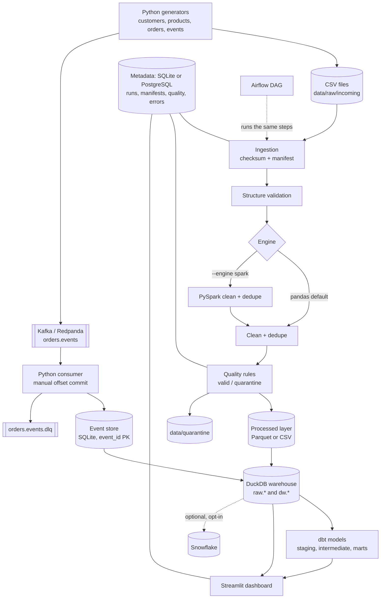

# Architecture

## Data flow

## Key engineering decisions
| Decision | Why |
|---|---|
| Steps are small functions (`prepare, ingest, validate, process, load_warehouse, dbt, final_quality, summary`) | The same code runs from the CLI and from Airflow tasks; each step is independently re-runnable. |
| State lives in the metadata store, not in process memory | Airflow tasks run in separate processes; `process` finds its work via manifests in status `validated`. |
| Manifest keyed by source file + SHA-256 checksum | Unchanged files are skipped *only* if already fully processed; a failed file is never silently skipped. |
| Processed layer = upsert by business key | Re-running a file cannot create duplicates; newest row per key wins. |
| Warehouse load = one transaction, full rebuild from the processed layer | Idempotent by construction; failure leaves the previous warehouse intact. |
| Surrogate keys = 60-bit hash of the business key | Stable across rebuilds (sequence keys would renumber). Uniqueness is asserted at build time. |
| Streaming store is SQLite (stdlib), not DuckDB | DuckDB allows one writer process; the consumer writes continuously while dbt/dashboard read. SQLite gives cheap transactional `INSERT OR IGNORE` on `event_id`. The warehouse load copies events into `raw.order_events`. |
| All dbt models are tables | Python replaces `raw.*` tables on each load; DuckDB views over them would block the replace. |
| Quality rules are data (dicts / optional JSON) with `severity` and `stage` | `error` rules quarantine rows, `warn` rules only record; cross-dataset consistency runs in the `final` stage after all datasets are loaded. |

## Delivery semantics (streaming)
* **At-least-once delivery:** offsets are committed manually, *after* the event is stored (or quarantined). A crash between
  store and commit makes the broker redeliver.
* **Effectively-once results:** `event_id` is the primary key; `INSERT OR IGNORE` makes redelivery harmless and the duplicate
  is counted in `duplicate_events`. Streaming sales also count each `order_id` once (earliest `order_created`), so a producer
  retry with a *new* event id does not inflate revenue either.
* **Not claimed:** end-to-end exactly-once (it would need transactional produce + consume, which this project does not implement).
* **Business time vs pipeline time:** `event_ts` (producer) drives analytics; `ingested_at` (consumer) drives observability.
  An event is flagged `is_late` when its `event_ts` is more than `LATE_EVENT_SECONDS` behind the newest event already stored;
  late events are still processed.

## Grain of the dimensional model
| Table | Grain |
|---|---|
| `dw.fact_orders` | one row per order |
| `dw.fact_order_items` | one row per order item (line) |
| `dw.fact_payments` | one row per payment transaction |
| `dw.fact_refunds` | one row per refund transaction |
| `dw.dim_customers`, `dw.dim_products` | one row per business key |
| `dw.dim_date` | one row per calendar day between the first and last transaction |

**Avoiding double counting:** `order_total` lives on the order grain. Anything joined to a one-to-many table (items,
payments, refunds) is either aggregated first (`item_count`, `units`, refunds per order in dbt) or summed at its own grain
(`line_total`). `tests/unit/test_revenue.py` shows a naive join inflating revenue and the order-grain total staying correct.

## Modes
* **Lightweight:** Python venv, pandas engine, CSV or Parquet, SQLite metadata. No Docker needed.
* **Full local:** Docker Compose for PostgreSQL (+ Redpanda with `--profile streaming`), PySpark engine, dbt, dashboard.
* **Airflow:** `docker-compose.airflow.yml` (heavy); orchestrates the same steps.
* **Snowflake:** opt-in loader, off by default.
