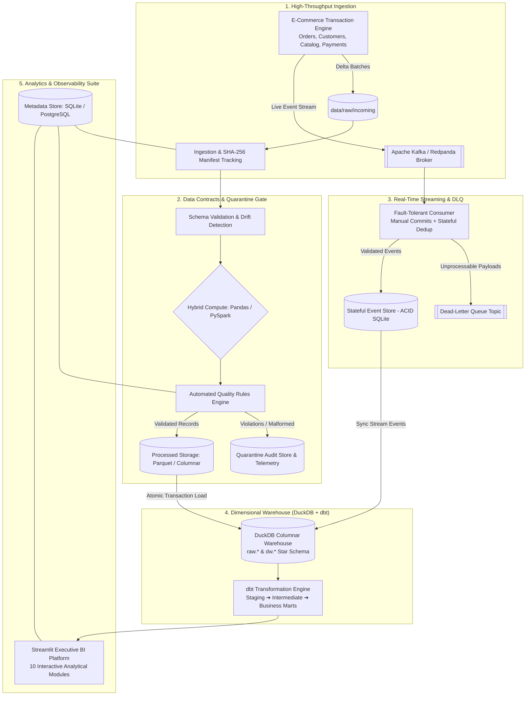

# 🛍️ StreamCommerce

[](https://github.com/Ayyappanmj/streamcommerce/actions/workflows/ci.yml)
[](https://www.python.org/downloads/)
[](https://www.getdbt.com/)
[](https://duckdb.org/)
[](https://redpanda.com/)
[](https://spark.apache.org/)
[](https://streamlit.io/)
[](https://github.com/astral-sh/ruff)
[](LICENSE)

**StreamCommerce** is an enterprise-grade, end-to-end e-commerce data engineering platform designed for high-throughput batch analytics and low-latency event streaming. Built with modern data stack best practices, it provides automated schema contracts, zero-data-loss quality quarantine, strict idempotent pipelines, a Kimball-modeled dimensional warehouse with dbt, Airflow orchestration, and an executive Streamlit BI analytics suite.

Engineered with a **cloud-ready, local-first architecture**: runs friction-free on local environments with zero external cloud dependencies while maintaining strict parity with production enterprise cloud deployments (Snowflake, BigQuery, Databricks).

---

## 🏗️ High-Level System Architecture



---

## 💼 Business Impact & Analytical Capabilities

StreamCommerce transforms raw, disparate transactional records into reliable financial and operational intelligence:

- **Customer Lifetime Value (CLV) & Cohorts**: Identifies high-value customers, RFM segments, and repeat purchase curves over rolling 30/60/90-day retention windows.
- **Financial Reconciliation & Margin Analysis**: Reconciles gross revenue, item discounts, shipping, and sales taxes against payment authorizations and refunds, eliminating discrepancies.
- **Product & Inventory Health**: Tracks SKU return rates, sales velocity, and inventory turnover to proactively identify problematic product lines.
- **Real-Time Operational Observability**: Live telemetry monitoring streaming throughput, ingestion latency, data contract drift, and quarantine error distributions.

---

## 🌟 Core Technical Highlights

### 🛡️ 1. Zero-Data-Loss Quality & Automated Quarantine
- **Strict Data Contracts**: Enforces schema constraints and domain rules on ingestion (non-negative currency, valid lifecycle statuses, non-null primary keys, referential validity).
- **Automated Quarantine Routing**: Rather than failing pipelines or silently dropping records, invalid records are routed to an isolated quarantine layer tagged with run IDs, timestamps, and actionable failure reasons.
- **Tiered Severity Classification**: Critical errors route to quarantine; non-fatal warnings log audit warnings without halting mission-critical downstream models.

### 🔁 2. Guaranteed Idempotency & Financial Precision
- **Digest-Based Change Detection**: Tracks SHA-256 checksums per file in a centralized metadata manifest. Unchanged batches are skipped, while partial failures re-execute safely without manual intervention.
- **Join Fan-Out Protection**: Solves the classic e-commerce revenue multiplication trap. Fact models aggregate line items and transactions to matching grains before joining, guaranteeing financial reports reflect true invoice totals.
- **Stable 60-Bit Surrogate Keys**: Uses deterministic natural key hashing instead of auto-incrementing integers, ensuring consistent surrogate identity across warehouse refreshes.

### ⚡ 3. Hybrid Compute Engine (Pandas & PySpark)
- **Vectorized In-Memory Engine**: High-performance Pandas & PyArrow execution path for sub-minute processing and zero-overhead local development.
- **Distributed Big Data Engine**: Switchable via `--engine spark` to run data transformations, schema evolution, and deduplication through Apache Spark (PySpark 3.5).

### 📡 4. Resilient Event Streaming & Dead-Letter Queue (DLQ)
- **At-Least-Once Delivery with Effectively-Once Persistence**: Explicit consumer offset commits executed strictly *after* transactional persistence.
- **Dead-Letter Queue (DLQ)**: Malformed or poisoned payloads automatically divert to `orders.events.dlq` for isolated triage without halting the ingestion consumer.
- **Late-Arriving Data Reconciliation**: Disentangles producer transaction timestamps (`event_ts`) from platform ingestion timestamps (`ingested_at`) to seamlessly handle out-of-order deliveries.

### 🏛️ 5. Kimball Star Schema Dimensional Modeling with dbt
- **Columnar Storage with DuckDB**: Blazing-fast analytical query execution without cloud database overhead.
- **15 Modular dbt Models across 3 Architectural Layers**:
  - `staging`: Source abstraction, schema normalization, and data type casting.
  - `intermediate`: Clean business joins (e.g. order-item line totals and refund rollups).
  - `marts`: Analytics-ready fact and dimension tables (`daily_sales`, `customer_lifetime_value`, `product_performance`, `refund_rate`, `repeat_purchase_rate`, `stream_sales`).
- **31 Automated dbt Integrity Tests**: Validates unique constraints, referential integrity, and business logic assertions across all models.

---

## 📊 Dimensional Star Schema Design

StreamCommerce implements a Kimball-style dimensional model optimized for fast slice-and-dice aggregations:

```
                           ┌─────────────────┐
                           │   dw.dim_date   │
                           └────────┬────────┘
                                    │
    ┌──────────────────────┐        │        ┌─────────────────────┐
    │   dw.dim_customers   │        │        │   dw.dim_products   │
    └──────────┬───────────┘        │        └──────────┬──────────┘
               │                    │                   │
               ▼                    ▼                   ▼
     ┌─────────────────────────────────────────────────────────┐
     │                     dw.fact_orders                      │
     │   (order_sk, customer_sk, order_date_sk, order_total)   │
     └─────────────┬─────────────────────────────┬─────────────┘
                   │                             │
                   ▼                             ▼
      ┌─────────────────────────┐   ┌───────────────────────────┐
      │   dw.fact_order_items   │   │     dw.fact_payments      │
      │ (item_sk, order_sk, ..) │   │ (payment_sk, order_sk, ..)│
      └─────────────────────────┘   └───────────────────────────┘
```

| Table | Grain | Key Metrics & Dimensions | Description |
|:---|:---|:---|:---|
| `dw.fact_orders` | One row per order | `order_total`, `tax_amount`, `shipping_amount`, `status` | Core transaction fact |
| `dw.fact_order_items` | One row per line item | `quantity`, `unit_price`, `line_total`, `discount_amount` | Detailed item purchase fact |
| `dw.fact_payments` | One row per payment | `amount`, `payment_method`, `status` | Payment authorization ledger |
| `dw.fact_refunds` | One row per refund | `refund_amount`, `reason` | Return and refund ledger |
| `dw.dim_customers` | One row per customer | `email`, `state`, `country`, `registration_date` | Customer dimensional profile |
| `dw.dim_products` | One row per product | `sku`, `category`, `price`, `cost` | Catalog dimensional entity |
| `dw.dim_date` | One row per calendar day | `year`, `quarter`, `month`, `day_of_week`, `is_weekend` | Enterprise date spine |

---

## 📐 Architectural Decisions & Design Trade-offs

| Engineering Decision | Rationale & Trade-off Consideration |
|:---|:---|
| **DuckDB as Warehouse** | Provides sub-second analytical execution on local disk without cloud provisioning costs, sharing identical SQL syntax and semantics with Snowflake / BigQuery. |
| **SQLite for Event Store** | DuckDB enforces single-writer access. SQLite provides lightweight, zero-latency ACID concurrency for real-time Kafka consumer writes while dbt and Streamlit query concurrently. |
| **Hash-Based Surrogate Keys** | Sequential auto-increment IDs drift when reloaded. Deterministic 60-bit SHA-256 surrogate keys ensure permanent referential stability across full warehouse rebuilds. |
| **At-Least-Once Consumer with Dedup** | End-to-end exactly-once streaming requires expensive distributed 2PC transactions. StreamCommerce achieves effectively-once results via idempotent primary-key upserts with negligible overhead. |
| **Dead-Letter Queue Isolation** | Poison-pill payloads never crash production consumers. Routing invalid events to a dedicated DLQ preserves uninterrupted streaming throughput. |

---

## 🚀 Quickstart Guide

### 1. Prerequisites
- **Python 3.11+**
- **Git**
- *(Optional)*: Docker Desktop (for containerized PostgreSQL, Redpanda Kafka, and Airflow orchestration)

### 2. Setup Environment
```bash
# Clone repository
git clone https://github.com/Ayyappanmj/streamcommerce.git
cd streamcommerce

# Create and activate virtual environment
python -m venv .venv
source .venv/bin/activate      # On Windows PowerShell: .\.venv\Scripts\Activate.ps1

# Install core and developer dependencies
pip install --upgrade pip
pip install -r requirements-dev.txt

# Initialize environment & dbt profiles
cp .env.example .env
cp dbt_project/profiles.yml.example dbt_project/profiles.yml
```

### 3. Run the End-to-End Pipeline
Execute data ingestion, schema validation, quality checks, DuckDB warehouse loading, and dbt analytics compilation in one command:
```bash
python -m src.batch_pipeline --generate --orders 2000 --with-dbt
```
*Execution telemetry, quality scorecards, and stage timings are recorded automatically in `data/processed/summaries/`.*

### 4. Run the Real-Time Streaming Ingestion Engine
Execute streaming event processing through the Kafka consumer with active deduplication and DLQ routing:
```bash
python -m src.ingestion.streaming_demo --transport file --orders 200 --duration 10
```

### 5. Launch the Executive BI Dashboard
```bash
streamlit run app/dashboard.py
```
Open **[http://localhost:8501](http://localhost:8501)** to access:
- 📈 **Sales Analytics**: Revenue trajectory, net vs. gross margin, and tax distributions.
- 👥 **Customer Analytics**: Customer Lifetime Value (CLV) cohorts and repeat purchase frequency.
- 📦 **Product Analytics**: High-performing SKUs and return rate tracking.
- ⚡ **Streaming Telemetry**: Real-time throughput, event lag, and deduplication metrics.
- 🔍 **Data Quality Explorer**: Audit-ready quarantine viewer and error breakdown.
- 🏛️ **Warehouse Explorer**: Interactive DuckDB catalog, column definitions, and row counts.

---

## 🧪 Testing & Quality Assurance

The codebase adheres to rigorous software engineering best practices with full test coverage:

```bash
# Run the automated test suite (55+ tests)
pytest -v

# Run static analysis and linting
ruff check .
```

### Automated CI/CD Pipeline
Every pull request and commit triggers GitHub Actions workflows to ensure production readiness:
- **Linting & Code Formatting**: Enforced via Ruff (`line-length = 130`, strict lint compliance).
- **Configuration Validation**: Schema validation for Docker Compose, CI workflows, and dbt specifications.
- **Unit & Idempotency Testing**: Verifies deduplication logic, deterministic keys, quarantine triggers, and financial calculations.
- **dbt Model Compilation & Tests**: Builds DuckDB tables and verifies all 31 data integrity tests.

---

## 📁 Repository Structure

```text
streamcommerce/
├── app/                        # Streamlit 10-page analytical BI platform
│   ├── components/             # Reusable UI widgets and DuckDB client helpers
│   └── pages/                  # Analytical views (Sales, Customers, Products, Streaming, DQ)
├── config/                     # Pipeline schemas and data contract rules
├── dags/                       # Apache Airflow orchestration DAG
├── data/                       # Local data storage (raw, processed, warehouse, quarantine)
├── dbt_project/                # dbt dimensional modeling project
│   ├── models/
│   │   ├── intermediate/       # Aggregated join models (e.g., int_order_items_clean)
│   │   ├── marts/              # Business intelligence marts (daily_sales, clv, etc.)
│   │   └── staging/            # Normalized views over raw tables
│   └── tests/                  # Custom business logic test assertions
├── docker/                     # Container configurations for services & Airflow
├── scripts/                    # Automation scripts for setup, testing, and execution
├── sql/                        # Warehouse schemas (DuckDB and PostgreSQL)
├── src/                        # Core application source code
│   ├── common/                 # Settings, schemas, structured logging, exceptions
│   ├── generators/             # Deterministic transactional event generation
│   ├── ingestion/              # Ingestion manifests, CSV parsers, Kafka streaming
│   ├── metadata/               # SQLite & PostgreSQL pipeline state repository
│   ├── processing/             # Dual-engine compute (Pandas / PySpark), deduplication
│   ├── quality/                # Data quality rules engine and validators
│   └── warehouse/              # DuckDB transactional loader and client
└── tests/                      # Automated test suite (unit, integration, data quality)
```

---

## 🛠️ Technology Stack

| Domain | Technologies |
|:---|:---|
| **Data Processing** | Python 3.11, Pandas, PyArrow, Apache Spark (PySpark 3.5) |
| **Data Warehouse** | DuckDB (Columnar OLAP with Star Schema) |
| **Data Transformation** | dbt-core 1.8, dbt-duckdb |
| **Streaming & Message Broker** | Apache Kafka / Redpanda, Confluent Kafka Python Client |
| **Pipeline Orchestration** | Apache Airflow 2.9 (Idempotent task retries, SLA logging) |
| **Metadata & State Store** | SQLite / PostgreSQL 16 (psycopg 3) |
| **Business Intelligence & UI** | Streamlit, Plotly Express |
| **Testing, Linting & CI/CD** | Pytest, Ruff, GitHub Actions CI |

---

## 📜 License
This project is open-source and available under the **[MIT License](LICENSE)**.
