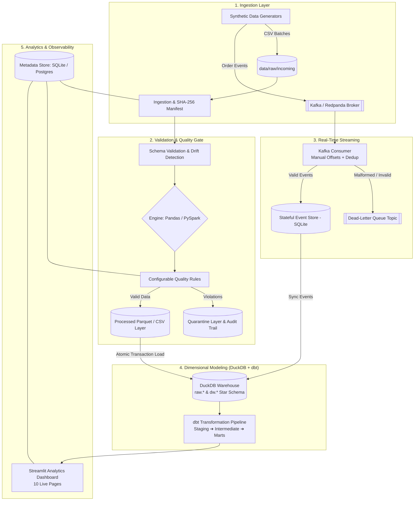

# 🛍️ StreamCommerce

[](https://github.com/Ayyappanmj/streamcommerce/actions/workflows/ci.yml)
[](https://www.python.org/downloads/)
[](https://www.getdbt.com/)
[](https://duckdb.org/)
[](https://redpanda.com/)
[](https://streamlit.io/)
[](https://github.com/astral-sh/ruff)
[](LICENSE)

An **end-to-end, production-grade e-commerce data engineering platform** built with modern data stack best practices. Supports dual-engine batch processing (Pandas & PySpark), real-time event streaming with Kafka, automated data quality validation with quarantine routing, a dimensional DuckDB warehouse modeled with dbt, Airflow orchestration, and an interactive Streamlit BI dashboard.

Designed to be **100% local-first and reproducible**: runs without requiring paid cloud infrastructure while demonstrating production software engineering standards (idempotency, schema evolution, transactional loads, and rigorous testing).

---

## 🏗️ System Architecture



---

## 🌟 Key Engineering Highlights

### 🛡️ 1. Data Quality Framework & Quarantine Layer
- **No Silent Drops**: Data is never dropped blindly. Incoming records are checked against configurable business rules (e.g. non-negative amounts, valid dates, foreign key presence, status integrity).
- **Audit-Ready Quarantine**: Rows with `error` severity are partitioned into quarantine files stamped with run IDs and specific failure reasons, while `warn` rules are recorded in metadata without stopping processing.
- **Cross-Dataset Consistency**: Final quality assertions evaluate referential integrity across all datasets before warehouse promotion.

### 🔁 2. Guaranteed Idempotency & Dedup Protection
- **SHA-256 Checksum Manifest**: Identical input files are detected and skipped automatically. Failed runs are safely re-runnable without manual cleanup.
- **Deterministic 60-bit Surrogate Keys**: Uses stable hashing of natural business keys rather than unstable auto-incrementing IDs, preserving surrogate key references across complete rebuilds.
- **Grain-Safe Aggregations**: Resolves classic one-to-many join fan-out traps. Order amounts are aggregated at the order grain before joining items/payments, ensuring financial figures never artificially inflate.

### ⚡ 3. Dual Processing Engine (Pandas + PySpark)
- **Lightweight Local Mode**: Ultra-fast execution with Pandas and PyArrow for rapid local iteration and zero-overhead CI/CD.
- **Distributed Big Data Mode**: Switchable via `--engine spark` to run data cleaning, deduplication, and type casting through Apache Spark (PySpark 3.5).

### 📡 4. Real-Time Event Streaming & DLQ
- **At-Least-Once Delivery with Effectively-Once Persistence**: Consumer manually commits offsets *only after* transactional storage into SQLite (`INSERT OR IGNORE` on `event_id`).
- **Dead-Letter Queue (DLQ)**: Malformed or unparseable event payloads are automatically published to a dedicated DLQ Kafka topic (`orders.events.dlq`).
- **Out-of-Order & Late Event Handling**: Tracks producer business time (`event_ts`) independently from pipeline arrival time (`ingested_at`), flagging late arrivals without dropping them.

### 🏛️ 5. Dimensional Modeling with dbt & DuckDB
- **Star Schema in DuckDB**: Modeled with explicit primary, foreign key, and check constraints across dimensions and facts.
- **Modular dbt Pipeline**: 15 SQL models partitioned into `staging`, `intermediate`, and `marts` layers:
  - `analytics.daily_sales`: Daily gross, net, discount, and tax metrics.
  - `analytics.customer_lifetime_value`: RFM-style segmentation, total orders, and average order value.
  - `analytics.product_performance`: Sales volume, revenue, and product refund rate.
  - `analytics.refund_rate`: Monthly refund frequency and lost revenue analysis.
  - `analytics.repeat_purchase_rate`: Cohort repeat customer behavior.
  - `analytics.stream_sales`: Real-time order metrics consolidated from event streams.
- **31 dbt Data Tests**: Automates schema tests (`unique`, `not_null`, `relationships`) and custom business logic assertions.

---

## 📊 Dimensional Star Schema

```
                           ┌─────────────────┐
                           │   dw.dim_date   │
                           └────────┬────────┘
                                    │
    ┌──────────────────────┐        │        ┌─────────────────────┐
    │   dw.dim_customers   │        │        │   dw.dim_products   │
    └──────────┬───────────┘        │        └──────────┬──────────┘
               │                    │                   │
               ▼                    ▼                   ▼
     ┌─────────────────────────────────────────────────────────┐
     │                     dw.fact_orders                      │
     │   (order_sk, customer_sk, order_date_sk, order_total)   │
     └─────────────┬─────────────────────────────┬─────────────┘
                   │                             │
                   ▼                             ▼
      ┌─────────────────────────┐   ┌───────────────────────────┐
      │   dw.fact_order_items   │   │     dw.fact_payments      │
      │ (item_sk, order_sk, ..) │   │ (payment_sk, order_sk, ..)│
      └─────────────────────────┘   └───────────────────────────┘
```

| Table | Type | Grain | Key Metrics / Attributes |
|:---|:---|:---|:---|
| `dw.fact_orders` | Fact | One row per order | `order_total`, `tax_amount`, `shipping_amount`, `status` |
| `dw.fact_order_items` | Fact | One row per line item | `quantity`, `unit_price`, `line_total`, `discount_amount` |
| `dw.fact_payments` | Fact | One row per transaction | `amount`, `payment_method`, `status` |
| `dw.fact_refunds` | Fact | One row per refund | `refund_amount`, `reason` |
| `dw.dim_customers` | Dimension | One row per customer | `email`, `state`, `country`, `registration_date` |
| `dw.dim_products` | Dimension | One row per product | `sku`, `category`, `price`, `cost` |
| `dw.dim_date` | Dimension | One row per calendar day | `year`, `month`, `quarter`, `day_of_week`, `is_weekend` |

---

## 🚀 Quickstart Guide

### 1. Prerequisites
- **Python 3.11+** installed
- **Git**
- *(Optional)*: Docker Desktop (for containerized PostgreSQL, Redpanda/Kafka, and Airflow)

### 2. Setup Environment
```bash
# Clone the repository
git clone https://github.com/Ayyappanmj/streamcommerce.git
cd streamcommerce

# Create virtual environment and install dependencies
python -m venv .venv
source .venv/bin/activate      # On Windows PowerShell: .\.venv\Scripts\Activate.ps1
pip install --upgrade pip
pip install -r requirements-dev.txt

# Copy environment configuration
cp .env.example .env
cp dbt_project/profiles.yml.example dbt_project/profiles.yml
```

### 3. Run the End-to-End Batch Pipeline
Generate synthetic e-commerce data, validate, process, load the DuckDB warehouse, and compile dbt marts in one command:
```bash
python -m src.batch_pipeline --generate --orders 2000 --with-dbt
```
*Output: Summary JSON with stage timings, record counts, and quality metrics saved to `data/processed/summaries/`.*

### 4. Run the Real-Time Streaming Demo
Replay synthetic real-time event streams through the consumer, testing stateful deduplication and DLQ routing:
```bash
python -m src.ingestion.streaming_demo --transport file --orders 200 --duration 10
```

### 5. Launch the Streamlit Analytics Dashboard
Explore interactive visual analytics, dimensional tables, data quality logs, and streaming monitors:
```bash
streamlit run app/dashboard.py
```
Open **[http://localhost:8501](http://localhost:8501)** in your browser:
- 📈 **Sales Analytics**: Revenue trends, AOV, tax, and discount breakdown.
- 👥 **Customer Analytics**: Customer Lifetime Value (CLV) distribution, cohort frequency.
- 📦 **Product Performance**: Top SKUs by volume and return/refund rates.
- ⚡ **Streaming Monitor**: Event throughput, late arrival rates, and dedup counters.
- 🔍 **Data Quality Explorer**: Full quarantine inspection and error log audit trail.
- 🏛️ **Warehouse Explorer**: Interactive DuckDB schema and metadata inspection.

---

## 🧪 Testing & CI/CD

The project enforces strict software engineering standards with an automated test suite covering unit tests, schema validation, quality quarantine, idempotency, and dbt models.

```bash
# Run the complete test suite (55+ tests)
pytest -v

# Run code style & linting checks
ruff check .
```

### GitHub Actions CI
Every commit and pull request runs automated GitHub Actions workflows:
- **Linting & Code Quality**: Enforced via Ruff (`line-length = 130`, zero lint violations).
- **YAML & Config Validation**: Validates all Docker Compose, CI, and dbt configuration files.
- **Unit & Idempotency Tests**: Verifies dedup logic, seed determinism, quarantine rules, and join fan-out safety.
- **dbt Model Compilation**: Verifies DuckDB models and runs automated schema/data tests.

---

## 📁 Repository Structure

```text
streamcommerce/
├── app/                        # Streamlit 10-page analytical dashboard
│   ├── components/             # Reusable UI widgets and DuckDB query helpers
│   └── pages/                  # Analytics pages (Sales, Customers, Streaming, DQ, Warehouse)
├── config/                     # Configuration definitions and schema specs
├── dags/                       # Apache Airflow batch orchestration DAG
├── data/                       # Local data directories (raw, processed, warehouse, quarantine)
├── dbt_project/                # dbt models, macros, sources, and schema tests
│   ├── models/
│   │   ├── intermediate/       # Cleaned join tables (e.g., int_order_items_clean)
│   │   ├── marts/              # Analytics dimensional marts (daily_sales, clv, etc.)
│   │   └── staging/            # Lightly cleaned views over raw warehouse tables
│   └── tests/                  # Custom dbt data integrity tests
├── docker/                     # Dockerfiles for pipeline services and Airflow
├── scripts/                    # PowerShell automation scripts (setup, run, tests)
├── sql/                        # Reference DDL schemas (DuckDB and PostgreSQL)
├── src/                        # Core Python application logic
│   ├── common/                 # Settings, schemas, structured logging, custom errors
│   ├── generators/             # Deterministic synthetic generators + fault injection
│   ├── ingestion/              # Checksum manifest, CSV loader, Kafka producer/consumer
│   ├── metadata/               # SQLite & PostgreSQL pipeline metadata repository
│   ├── processing/             # Pandas & PySpark processors, dedup, transformations
│   ├── quality/                # Configurable quality rules engine and validators
│   └── warehouse/              # DuckDB client and transactional warehouse loader
└── tests/                      # Automated test suite (unit, integration, data quality)
```

---

## 🛠️ Technology Stack

| Category | Technologies |
|:---|:---|
| **Language & Frameworks** | Python 3.11, Pandas, PyArrow, PySpark 3.5 |
| **Data Warehouse** | DuckDB (Star schema with local analytical query engine) |
| **Data Transformation** | dbt-core 1.8, dbt-duckdb |
| **Streaming & Messaging** | Apache Kafka / Redpanda, Confluent Kafka Python Client |
| **Orchestration** | Apache Airflow 2.9 (Dockerized DAG with retries and task logging) |
| **Metadata & State** | SQLite (default lightweight) / PostgreSQL 16 (psycopg 3) |
| **Visualization & BI** | Streamlit, Plotly Express |
| **Testing & CI/CD** | Pytest, Ruff, GitHub Actions CI |

---

## 📜 License
Distributed under the **MIT License**. See [`LICENSE`](LICENSE) for details.
