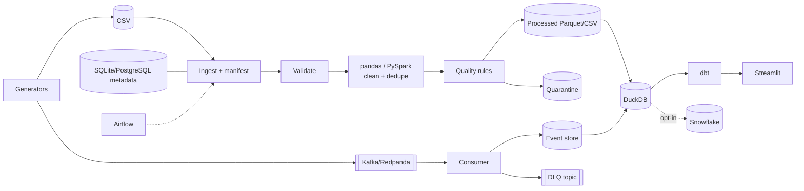

# StreamCommerce – real-time e-commerce data engineering platform

A local-first data platform that processes customer, product, order, payment and refund data through **batch** and
**streaming** pipelines: Python + PySpark processing, a quality framework with quarantine, idempotent persistence,
a DuckDB dimensional warehouse, dbt models, Airflow orchestration, PostgreSQL metadata, a Streamlit dashboard and an
optional Snowflake loader. It needs no paid cloud account. All data is synthetic.

> **Read "Verification status" first.** The code was written and tested in a sandbox without network access, so some
> components could not be executed. Nothing below is claimed as working unless it is listed as verified.

## Verification status
| # | Criterion | Status |
|---|---|---|
| 1 | Dependencies install in a clean environment | **Not verified** (no network in the build sandbox). `requirements.txt` is a set of constraints, not a tested lock file. |
| 2 | Sample data generation | **Verified** (deterministic; fixed seed gives identical output; fault injection tested). |
| 3 | Batch pipeline executes | **Verified** with the pandas engine and CSV processed layer (steps prepare → summary, minus warehouse/dbt). |
| 4 | PySpark transformations | **Not verified** (pyspark not installed). `src/processing/spark_processor.py` is untested code. |
| 5 | Parquet output | **Not verified** (pyarrow not installed); code path is a plain `DataFrame.to_parquet`. CSV mode verified. |
| 6 | DuckDB tables | **Not verified** (duckdb not installed). Tests exist and are skipped without duckdb. |
| 7 | dbt models | **Not verified** (dbt/duckdb not installed). SQL and YAML were written carefully but never executed. |
| 8 | Quality checks catch invalid records | **Verified** (tests inject faults and check quarantine reasons). |
| 9 | Reprocessing does not duplicate | **Verified** for the processed layer (re-run, forced re-run, overlapping batch). Warehouse idempotency test exists but was skipped (no duckdb). |
| 10 | Streaming produces/consumes via a broker | **Not verified** (no Kafka client/broker). The validation/dedup/persistence code the consumer calls **is** verified through `--transport file` replay and unit tests. |
| 11 | Duplicate events do not inflate totals | **Verified** (store level, including replay and restart simulation). |
| 12 | Invalid events quarantined | **Verified** in the event store. DLQ topic publishing is **not verified**. |
| 13 | PostgreSQL metadata | **Not verified** (psycopg/Postgres unavailable). The same repository code is verified on SQLite. |
| 14 | Airflow DAG | **Only syntax-checked** (`py_compile`); `airflow` not installed so the import was not tested. |
| 15 | Streamlit dashboard launches | **Not verified**; pages only syntax-checked. |
| 16 | Unit tests pass | **51 passed, 0 failed, 5 skipped** – run with a minimal pytest stand-in because real pytest could not be installed. Run the suite with real pytest (`scripts\run_tests.ps1`) to confirm. Skipped: duckdb, dbt, Kafka, PostgreSQL tests, and the DuckDB idempotency test. |
| 17 | Ruff | **Not verified** (ruff not installed). A custom script checked line length (≤130) and obvious unused imports. |
| 18 | CI configuration | YAML parses; the workflow itself has **not been run** on GitHub. |
| 19 | README commands match implementation | Python CLI commands below were executed (batch, generator, streaming `--transport file`). PowerShell scripts were **not executed** (no Windows/PowerShell). |
| 20 | Snowflake optional | **Verified** structurally: nothing in the core imports `src.snowflake`. The loader itself was never run against Snowflake. |

No performance benchmarks were measured; none are claimed.

## Architecture

Details and design decisions: [ARCHITECTURE.md](ARCHITECTURE.md). Fields and rules: [DATA_DICTIONARY.md](DATA_DICTIONARY.md).

## Features
Deterministic generators with optional fault injection (duplicates, negative amounts, missing IDs, malformed rows,
late and out-of-order events) · checksum manifest with skip-unchanged · schema validation and drift reporting ·
configurable quality rules (error → quarantine, warn → record) · idempotent upserts · transactional warehouse rebuild ·
dimensional model with PK/FK/CHECK constraints · dbt staging/intermediate/marts with tests · at-least-once Kafka consumer
with manual offsets, dedup and DLQ · pipeline run metadata · 10-page Streamlit dashboard (empty states, no fabricated metrics) ·
Airflow DAG with retries/timeouts/failure log · optional Snowflake loader with dry-run.

## Technology stack
Python 3.11+, pandas, PyArrow/Parquet, PySpark 3.5, DuckDB, dbt-core + dbt-duckdb, Confluent-Kafka (Redpanda locally),
PostgreSQL 16 (psycopg 3), Airflow 2.9, Streamlit + Plotly, pytest, Ruff, Docker Compose, GitHub Actions.

## Prerequisites
Python 3.11+, Git. Optional: Docker Desktop (PostgreSQL, Redpanda, Airflow), JDK 17 (PySpark engine).

## Setup (PowerShell)
```powershell
.\scripts\verify_environment.ps1        # check Python / Docker / Java
.\scripts\setup.ps1                      # venv + dependencies + .env
.\.venv\Scripts\Activate.ps1
```
If scripts are blocked: `Set-ExecutionPolicy -Scope Process -ExecutionPolicy Bypass`.

## Mode 1 – lightweight (no Docker)
```powershell
.\scripts\generate_data.ps1 -Orders 2000                          # optional: only writes CSV + events.jsonl
.\scripts\run_batch.ps1 -Orders 2000                              # generate -> ingest -> ... -> DuckDB (pandas engine)
.\scripts\run_batch.ps1 -Orders 2000 -WithDbt                     # also run dbt build
.\scripts\run_batch.ps1 -NoGenerate                               # re-run on the files already in data\raw\incoming (unchanged files are skipped)
.\scripts\run_batch.ps1 -Faults -Orders 500 -Force                # inject faults; look at data\quarantine\
.\scripts\run_batch.ps1 -Engine spark -Orders 2000                # PySpark engine (needs Java)
streamlit run app/dashboard.py                                    # dashboard on http://localhost:8501
```
Equivalent without scripts: `python -m src.batch_pipeline --generate --orders 2000 --with-dbt`.
Run selected steps: `python -m src.batch_pipeline --steps process,final_quality,summary`.
Use `PROCESSED_FORMAT=csv` in `.env` if you do not have pyarrow. Each run prints a JSON execution summary and saves it in
`data/processed/summaries/<run_id>.json`.

dbt manually: `cd dbt_project; dbt build --profiles-dir .` (copy `profiles.yml.example` to `profiles.yml` first; run `load_warehouse` before).

## Mode 2 – streaming
```powershell
docker compose --profile streaming up -d           # Redpanda on localhost:19092 (set KAFKA_BOOTSTRAP_SERVERS in .env)
.\scripts\run_streaming.ps1 -Orders 200 -Duration 30 -Faults   # produce, consume, print counts, exit
.\scripts\run_streaming.ps1 -Transport file -Faults            # no broker: replay through the same processing code
```
The demo ends when `--duration` elapses, the stream is idle for `--idle-timeout`, or on Ctrl+C (graceful: commits are
already done per message, then the consumer closes). Re-running does not change totals. Invalid events go to the
`quarantined_events` table and the `orders.events.dlq` topic. Load the events into the warehouse with
`python -m src.batch_pipeline --steps load_warehouse`.

## Mode 3 – PostgreSQL metadata
```powershell
# in .env: METADATA_BACKEND=postgres and POSTGRES_PASSWORD=<your password>
docker compose up -d postgres
python -m src.batch_pipeline --generate --orders 1000
python -c "from src.common.config import Settings; from src.ingestion.postgres_ingestion import load_reference_data as f; print(f(Settings.from_env()))"
```
Without PostgreSQL the default `METADATA_BACKEND=sqlite` is used; selecting `postgres` while it is down fails with a clear error.

## Mode 4 – Airflow
```powershell
docker compose -f docker-compose.airflow.yml up -d --build
docker compose -f docker-compose.airflow.yml logs airflow     # standalone prints the admin password
# UI: http://localhost:8080 -> trigger DAG "streamcommerce_batch_pipeline"
```
Schedule (`STREAMCOMMERCE_SCHEDULE`, `none` for manual), catch-up (`STREAMCOMMERCE_CATCHUP`), retries (2), 30-minute task
timeouts, failures logged to `data/processed/alerts.log`. Every task is idempotent, so reruns and backfills are safe.
This mode is resource heavy and untested here.

## Optional – Snowflake
Disabled by default; nothing imports it. See [src/snowflake/README.md](src/snowflake/README.md) for setup, key-pair
auth, `--dry-run`, disabling and cost notes.

## Testing
```powershell
.\scripts\run_tests.ps1               # Ruff + pytest -m "not external"
.\scripts\run_tests.ps1 -External     # also Kafka / PostgreSQL / dbt tests when available
```
External tests: `KAFKA_TEST_BOOTSTRAP=localhost:19092`, `POSTGRES_TEST_PASSWORD=...`, dbt + duckdb installed.
Test areas: generators, schema validation, transformations, deduplication, quality/quarantine, event processing,
revenue (join fan-out), manifest handling, configuration, idempotency (batch, events, warehouse).

## Stop and reset
```powershell
docker compose down                        # keeps volumes; add -v to delete database volumes
docker compose -f docker-compose.airflow.yml down
.\scripts\reset_demo_data.ps1              # asks you to type RESET; deletes only generated data under .\data
```

## Known limitations
* Not executed here: PySpark, Parquet, DuckDB, dbt, Kafka, PostgreSQL, Airflow, Streamlit, Snowflake, Docker, PowerShell (see status table).
* The Spark engine reads with `DROPMALFORMED`; malformed lines are reported by a Python scan, and Spark's treatment of rows with *too few* fields may differ from the pandas path.
* Streaming state is SQLite (single node); no schema registry; DLQ publish happens after the DB write and before the offset commit, so a crash there can publish a duplicate to the DLQ.
* Quarantine files are an append-only audit trail (a forced re-run writes a new file).
* Rows rejected in one dataset cascade to children that reference them (e.g. items of a rejected order).
* Dependency versions are constraints that were not installed together here.

## Future improvements
Verify and pin a lock file; schema registry (Avro/JSON Schema); transactional exactly-once Kafka pipeline; incremental dbt
models; Great Expectations-style reports; Spark structured streaming; Prometheus metrics; screenshot gallery.
